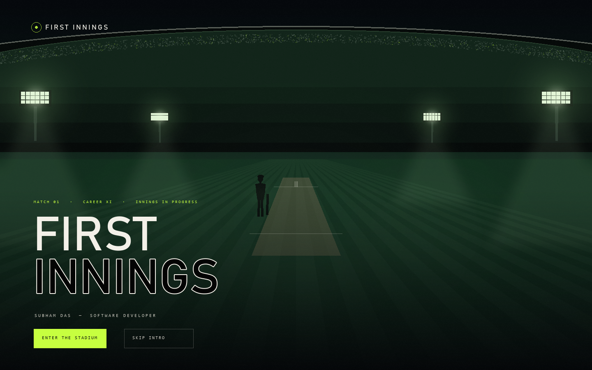
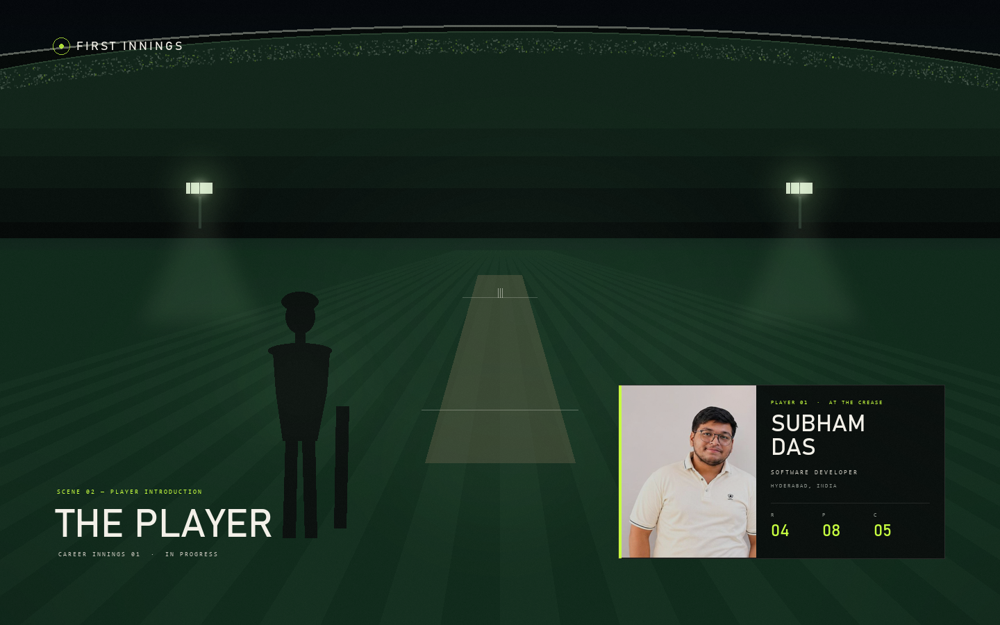
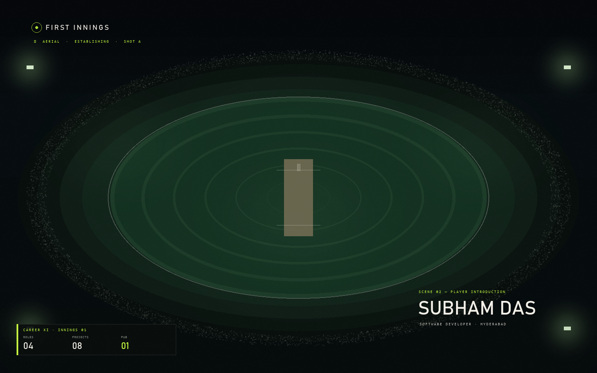
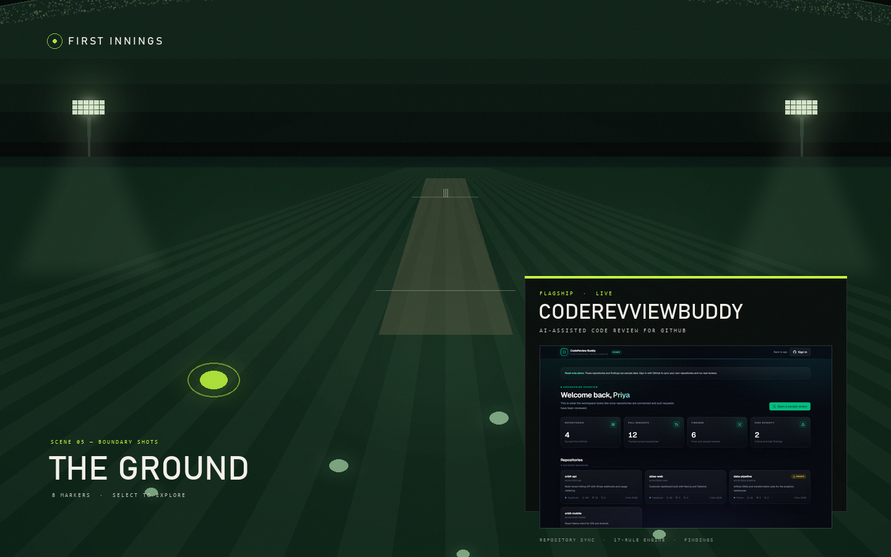
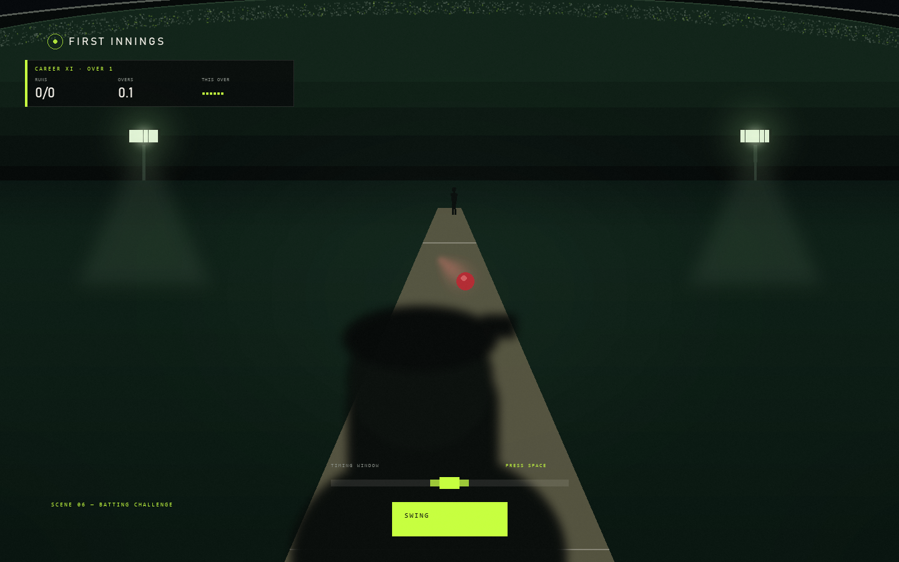
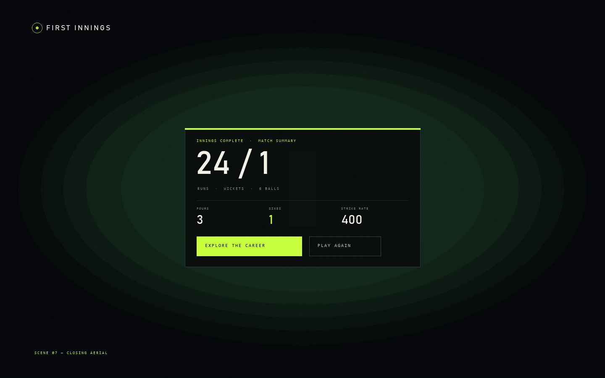
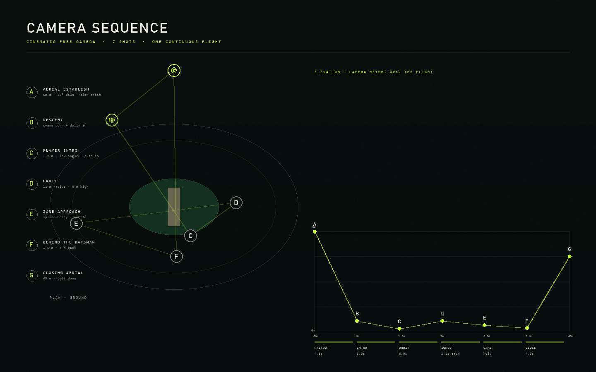

# FIRST INNINGS — revised creative blueprint
## Direction C · The Interactive Cricket Career Experience
### Cinematic Free Camera approved as the primary camera language

Status: **awaiting approval — nothing implemented**
Prepared 12 November 2026 · supersedes the linear-scroll parts of `phase-0-blueprint.md`

---

## 1. What was wrong, honestly

The current build is a good-looking website with a cricket skin. You asked for a cricket game that happens to contain a portfolio. Three things cause the gap:

1. **The camera is the page.** In the current build the only "camera" is vertical scrolling. A portfolio that scrolls is a document, whatever you paint on it. Spatial navigation is what makes something feel like a place.
2. **Cricket is a label layer, not a system.** "Career Innings" is a heading above a list. In a game, an innings *is* a stateful object with runs, wickets and time. Right now nothing in the experience has state except the scroll position.
3. **The world is flat.** An SVG bowl with parallax reads as illustration. Depth — real geometry, real light falloff, occlusion, a camera that moves through it — is what makes an environment feel entered.

The fix is not "add 3D". It is to make **navigation spatial and stateful**, and let the broadcast layer do the explaining.

---

## 2. The concept

> You walk out of the tunnel into a floodlit ground. The camera is a drone operator who already knows the story. It flies you to the crease, introduces the player, then takes you around the ground — the pavilion, the boundary, the markers on the outfield, the practice nets, the scoreboard — before setting you behind the stumps to face six balls. The scorecard at the end is your invitation.

Three layers, always present together:

| Layer | Technology | Job |
|---|---|---|
| **A. The world** | Three.js / R3F | Stadium, pitch, lights, crowd, players, ball, camera |
| **B. The broadcast** | HTML + CSS over the canvas | Score bug, lower thirds, player card, commentary, match centre, dialogs |
| **C. The portfolio** | Existing data files | The actual content, surfaced through B at each world anchor |

**Nothing in layer C changes.** Every fact, project, role, skill and certificate stays exactly as verified. What changes is *how you arrive at it*.

---

## 3. Concept frames

Look-development frames, 1440 × 900. The 3D world is shown as a **blockout** — geometry and lighting will be real in the build; these establish composition, camera and the broadcast language.

| Frame | What it shows |
|---|---|
|  | **01 — Walkout.** Tunnel shadow, floodlit field beyond, player silhouette, title plate |
|  | **02 — Player introduction.** Low angle at the crease, broadcast player card with the real photograph |
|  | **03 — Aerial establishing.** Overhead drift over the bowl, career totals on the score bug |
|  | **04 — The ground.** Eight markers on the outfield, flagship panel open with the real CodeReviewBuddy UI |
|  | **05 — Batting challenge.** Behind the batsman, ball in flight, timing window, swing control |
|  | **06 — Closing aerial.** Scorecard over the ground, career invitation |
|  | **07 — Camera sequence.** Seven shots, plan and elevation |

---

## 4. Storyboard — six stages

### Stage 1 · Walkout `~0–4.5s`
Camera starts inside the tunnel at eye height, looking out. The frame is mostly dark; a bright slot of ground and floodlight bank ahead. As it moves forward the shadow opens. A silhouetted player walks ahead of camera. The title plate rises. `ENTER THE STADIUM` is available from frame one; `SKIP INTRO` from frame one.

**Camera:** A → B. `y: 12m → 6m`, `z: −48m → −26m`, look-at locked ahead, 4.5 s, `power2.inOut`.

### Stage 2 · Player introduction `~4.5–8s`
The camera drops to 1.2 m and swings to a low three-quarter at the crease. The player figure turns to camera. The broadcast player card slides in from the right with the real photograph, name, role, and three real totals (roles / projects / certifications). Commentary line appears once, bottom left.

**Camera:** C. Slow push-in `z: +2.4m`, `fov 38 → 32`, 3 s.

### Stage 3 · Main match environment `~8–14s`
Camera lifts and pulls back into a slow orbit at 6 m, 12 m radius, 20°/s. The match centre becomes interactive. The visitor now chooses where to go — or lets the orbit continue.

**Camera:** D. Continuous orbit; breaks on first input.

### Stage 4 · Career exploration
Selecting **Career** flies the camera to the boundary anchor on the left. The career innings appears as a horizontal strip of match cards anchored in world space, the current role highlighted as "at the crease". The camera tracks slowly along the strip as the visitor moves through it.

**Camera:** E (boundary). Spline dolly, 2.2 s, with a 120 ms settle.

### Stage 5 · Project exploration
Selecting **Projects** pulls the camera up to a 35° overhead of the outfield. Eight markers glow at their positions; the flagship sits on the pitch itself. Selecting a marker dollies the camera to it and opens the existing project panel — the panel does not change, only how you got there.

**Camera:** E (outfield). Dolly to marker, `fov 42 → 36`.

### Stage 6 · Batting challenge and close
`FACE THE BOWLER` cuts to behind the stumps. Six balls. Then the camera rises to 45 m, tilts down, and the closing scorecard resolves over the ground with `EXPLORE THE CAREER` and `CONTACT`.

**Camera:** F → G. Rise 4 s, `power2.out`.

---

## 5. Cinematic Free Camera

### 5.1 The rig

Not a free-fly camera. A **scripted rig with a spline bus** — the visitor never flies it, which is what keeps it cinematic rather than fiddly.

```
CameraRig
├─ rig.position      (Vector3, driven by GSAP)
├─ rig.target        (Vector3, look-at)
├─ rig.fov           (number)
├─ rig.roll          (number, ±3° for banking)
└─ shake             (trauma 0–1, decays at 0.9/s)
```

A single `CameraDirector` owns a queue of shots. Each shot is:

```ts
type Shot = {
  id: string
  from?: CameraState          // omitted = start from current
  to: CameraState
  duration: number
  ease: string                // "power2.inOut" | "power3.out" | ...
  path?: 'straight' | 'spline'
  onComplete?: () => void
}
```

Only one shot runs at a time. A new request **interrupts** the current shot by capturing its live state as `from` and re-tweening — no snapping, no queue pile-up. That single rule is what makes camera movement feel intentional rather than a pile of animations.

### 5.2 The seven shots

| Shot | Name | Position (m, ground origin) | Look-at | FOV | Move |
|---|---|---|---|---|---|
| **A** | Aerial establish | `(0, 60, −40)` | `(0, 0, 0)` | 45 | slow orbit 8°/s |
| **B** | Descent | `(0, 6, −26)` | `(0, 1.2, 4)` | 40 | crane + dolly |
| **C** | Player intro | `(4.5, 1.2, 6)` | `(0, 1.1, 0)` | 38→32 | push-in |
| **D** | Orbit | radius 12, `y 6` | `(0, 0.8, 0)` | 42 | 20°/s orbit |
| **E** | Zone approach | per-anchor | per-anchor | 42→36 | spline dolly |
| **F** | Behind the batsman | `(0, 1.6, 8.5)` | `(0, 1.2, −12)` | 34 | hard cut |
| **G** | Closing aerial | `(0, 45, −30)` | `(0, 0, 0)` | 50 | rise + tilt |

### 5.3 Zone anchors

| Zone | World position | Camera arrives | Duration |
|---|---|---|---|
| Pavilion — About | `(−34, 0, 18)` | `(−22, 2.4, 26)`, look `(−34, 2, 18)` | 2.2 s |
| Boundary — Career | `(−46, 0, −6)` | `(−30, 3.2, −6)`, look `(−46, 1.6, −6)` | 2.2 s |
| Outfield — Projects | `(30, 0, 14)` | `(18, 9, 22)`, look `(30, 0, 10)` | 2.0 s |
| Nets — Skills | `(40, 0, −30)` | `(30, 2.2, −22)`, look `(40, 1.4, −30)` | 2.2 s |
| Scoreboard — Records | `(0, 14, −58)` | `(0, 6, −40)`, look `(0, 14, −58)` | 2.6 s |
| Media box — Contact | `(−16, 9, −46)` | `(−12, 8, −36)`, look `(−16, 9, −46)` | 2.4 s |

Transitions are **cuts only where the illusion needs one** (into the game), **splines everywhere else**. A cut inside the portfolio would break the "one continuous flight" promise.

### 5.4 Restraint rules

- **No free orbit.** Pointer adds ±1.5° yaw / ±1° pitch of parallax, damped at 4/s. It is seasoning, not control.
- **No camera movement while reading.** When a panel is open the rig holds and only breathes (0.05 m amplitude, 6 s cycle).
- **Never move the camera to signal a UI change** the visitor did not cause.
- **Respect reduced motion:** instant cuts between anchors, no orbit, no parallax, no push-ins. Same content, no flight.

### 5.5 Mobile

The full flight is a desktop experience. On phones the rig runs a **reduced shot list**: A (static aerial) → cut to C → orbit is replaced by a 3-second establishing drift → zone approaches become simple 0.8 s pushes. No splines, no banking, no parallax. Target 12 s of camera motion on mobile versus 40 s on desktop.

---

## 6. 3D environment architecture

### 6.1 Scene graph

```
<Canvas dpr={[1, 1.75]} gl={{ antialias: true, powerPreference: 'high-performance' }}>
  <Suspense fallback={<Curtain />}>
    <World>
      <Sky />                    // gradient shader dome, no texture
      <StadiumBowl />            // lathe + instanced tiers
      <Roof />                   // instanced trusses
      <Crowd />                  // InstancedMesh, 8k quads
      <Pitch />                  // plane + procedural canvas texture
      <Outfield />               // ring geometry + stripe shader
      <BoundaryBoards />         // instanced panels with emissive strips
      <Floodlights />            // 4 towers, 4 cones, 4 emissive banks
      <Players />                // batsman, bowler, umpire (low-poly)
      <Ball />
      <Zones />                  // 6 anchors, glow rings
      <Atmosphere />             // fog + dust points + light shafts
    </World>
    <CameraRig />
  </Suspense>
</Canvas>
```

### 6.2 Geometry strategy — procedural, not purchased

| Element | How it is built | Triangles |
|---|---|---|
| Bowl | `LatheGeometry` from a tiered profile curve, 64 segments | ~12k |
| Roof | `InstancedMesh` of 240 box trusses | ~5k |
| Crowd | `InstancedMesh` of 8,000 low-poly quads, vertex-colour shimmer | 8k quads |
| Pitch | single plane, 1 procedural canvas texture (1024²) | 2 |
| Outfield | circle geometry, custom stripe shader | ~200 |
| Boards | 96 instanced panels + emissive strips | ~1k |
| Towers | cylinders + boxes, 4 instances | ~2k |
| Players | low-poly rig, ~1.8k tris each | ~5k |
| **Total** | | **~35k** |

That is deliberately small. The look comes from lighting and atmosphere, not from polygon count.

### 6.3 Lighting — the part that decides whether it feels real

Real stadium lighting is four enormous area sources high above a dark field. We fake that:

- **1 `HemisphereLight`** — sky `#1b3a2c`, ground `#0a1410`, intensity 0.55. Kills pure black.
- **1 `DirectionalLight`** — from the main tower, intensity 1.1, **no shadows**.
- **4 fake cones** — additive `ConeGeometry` with a gradient alpha shader, `depthWrite: false`, `blending: AdditiveBlending`. These do the visual work.
- **1 blob shadow** — a radial-gradient plane under the batsman, 0.35 opacity.
- **Emissive lamp banks** — `MeshStandardMaterial` with `emissiveIntensity` 3, plus a sprite glow.

**No `castShadow` anywhere.** Shadow maps across a 100 m stadium are the single fastest way to turn 60 fps into 18. A contact shadow under the players is enough.

### 6.4 Atmosphere

- **Fog** `FogExp2(0x08120f, 0.008)` — this is what makes the far stands recede.
- **Dust** — 400 points, slow upward drift, additive, 2 px.
- **Light shafts** — 4 additive quads from each tower, rotating 0.5°/s.
- **Colour grade** — a CSS overlay on the canvas container (vignette + slight green lift). Cheaper than a post pass.

**No postprocessing in v1.** Bloom is ~2 ms/frame at 1440p and is the first thing to cut on mobile. The look is achieved with additive sprites instead. If the budget allows later, `@react-three/postprocessing` Bloom at half resolution becomes an optional tier.

### 6.5 Players

This is the honest constraint. Photoreal cricketers need rigged, textured, animated models — an asset pipeline I cannot fabricate.

**Proposal: stylised low-poly figures.** Capsule limbs, helmeted head, bat. Materials flat with rim light. Animated procedurally: bat backlift and swing driven by a single `t` 0→1, bowler run-up on a 3-key cycle. At stadium distance, in this lighting, a well-lit silhouette reads better than a mediocre imported model.

Subham's *likeness* stays photographic — it lives in the broadcast player card, not on a 3D body. That is honest and looks deliberate.

---

## 7. Broadcast layer

HTML/CSS on top of the canvas, all of it reusing the token system already built.

| Component | Behaviour |
|---|---|
| **Score bug** | Persistent bottom-left during stages 3–6. Career totals, not fake cricket stats |
| **Lower third** | On every camera arrival; 1.8 s in, 4 s hold, 1.2 s out |
| **Player card** | Stage 2 only; photograph, role, three real totals |
| **Commentary** | 6–8 lines total across the whole experience, tied to camera arrivals, dismissible |
| **Match centre** | The existing bar, restyled to sit above the canvas |
| **Project panel** | The existing dialog, unchanged |
| **Scorecard** | Stage 6 close |

Motion: GSAP for camera, Motion for overlays, CSS for micro-interactions — the same split the project already uses.

---

## 8. How the portfolio becomes spatial

The rule: **each zone gets a different presentation device**, so the visitor is never just reading the same card layout in a different place.

| Zone | World device | Content |
|---|---|---|
| **Pitch** | The crease itself; the game happens here | Current role, the six-ball challenge |
| **Pavilion** | A character card pinned in 3D space, like a squad screen | About, summary, education, focus |
| **Boundary** | Innings strip along the rope — one card per role, chronological | Experience |
| **Outfield** | 8 glowing markers; flagship on the pitch | Projects |
| **Nets** | Training stations — skill groups as bays | Skills |
| **Scoreboard** | The literal 3D scoreboard, camera tilts up to it | Publication, certifications, CGPA |
| **Media box** | Interview desk | Contact, resume |

If a visitor never moves the camera, the match centre still lists all six. **No content is reachable only by exploring** — that rule from the original brief survives.

---

## 9. Gameplay

### 9.1 The over

Six deliveries. One wicket ends the over. Deterministic per innings via a seeded PRNG so the same timing always produces the same result — skill, not luck.

### 9.2 Timing model

Ball releases at `t=0`, reaches the impact plane at `t=T`. Delivery type sets `T`:

| Delivery | `T` | Telegraph |
|---|---|---|
| Stock | 1050 ms | normal arm |
| Quick | 880 ms | faster run-up |
| Slower ball | 1250 ms | arm slows |

`Δ = t_press − T` in milliseconds.

| |Δ| | Outcome | Visual |
|---|---|---|
| ≤ 35 | **SIX** | Ball leaves the ground, crowd swells, six-card |
| 36–80 | **FOUR** | Ball skims along the ground to the rope |
| 81–140 | **2** | Ball placed into the gap |
| 141–200 | **1** | Nudge |
| 201–260 | **Dot** | Played and missed, bat swings late |
| > 260 or no input | **Dot**, or **WICKET** on a straight delivery | Stumps break, shake |

Swinging **before release** is a wicket. Three consecutive dots triggers a "pressure" state and the next delivery speeds up 8%.

### 9.3 Aim (the second input)

Timing alone makes every shot identical. A second, optional input gives the shot a direction:

- **Desktop:** `A`/`D` or ←/→ to pick leg side / off side before the ball arrives.
- **Touch:** drag toward the side of the ground; release to swing.

Aim shifts the ball's launch azimuth by ±28°. A perfectly timed shot with no aim goes straight. This is a small mechanic that adds a lot of replay value without a second button.

### 9.4 Controls

| Platform | Swing | Aim |
|---|---|---|
| Desktop | `Space`, click, or the SWING button | `←` `→` |
| Touch | tap anywhere in the play area | drag left/right |
| Keyboard nav | SWING is a real `<button>`; `Space` only captured while the game section has focus | — |

### 9.5 Scoreboard

`RUNS / WICKETS · OVERS · STRIKE RATE · FOURS · SIXES · ball-by-ball strip`. Every number is a real game number, never presented as a professional statistic.

### 9.6 End state

`24 / 1` style card, ball-by-ball strip, best-shot replay label, and two actions: `EXPLORE THE CAREER`, `PLAY AGAIN`. High score in `localStorage`, labelled as stored on this device only.

---

## 10. Desktop and mobile

| | Desktop | Mobile |
|---|---|---|
| Viewport | 1440 × 900 | 390 × 844 |
| Camera | Full 7-shot flight, splines, orbit, parallax | 3 shots, cuts, one drift, no parallax |
| DPR | `[1, 1.75]` | `[1, 1.25]` |
| Crowd | 8,000 | 1,500 |
| Dust | 400 | 80 |
| Cones | 4 additive | 2 additive |
| Players | 3 rigged | 2 rigged |
| Match centre | Full broadcast bar | Compact pill + sheet |
| Game | Behind-batsman 3D | **2D canvas overlay** — same timing, drawn in 2D |

The mobile game being 2D is a deliberate call: a 3D behind-the-stumps scene at 390 px offers no more information than a well-drawn 2D version, and costs 4× the frame time.

---

## 11. Performance and fallback

### 11.1 Budget

| Metric | Desktop | Mobile |
|---|---|---|
| Frame time | ≤ 12 ms (60 fps) | ≤ 26 ms (≥ 38 fps) |
| Draw calls | ≤ 80 | ≤ 40 |
| Triangles | ≤ 200k | ≤ 60k |
| Lights | 1 hemi + 1 dir + additive cones | 1 hemi + additive cones |
| Shadow maps | none | none |
| Added JS (gzip) | ~170 KB (three + R3F) | same, cached |

### 11.2 Fallback ladder

| Tier | Trigger | Experience |
|---|---|---|
| **L0 Full** | WebGL2, ≥ 4 GB, desktop | 3D world, full camera flight |
| **L1 Reduced** | mobile, or `deviceMemory < 4` | 3D world, fewer instances, 3-shot camera |
| **L2 Curtain** | WebGL unavailable, or sustained < 25 fps | **The current Phase 2 SVG stadium**, static, with Ken Burns drift — content fully available |
| **L3 Document** | no JS | `/recruiter` is a real document and works on its own |

The L2 tier is why Phase 2 matters: **the existing stadium becomes the graceful degradation**, not dead code. We already built it. It is the right fallback.

Downgrade is automatic: a 3-second frame-time probe runs on start; if the median exceeds 26 ms, we drop a tier and persist the choice.

### 11.3 Loading

- The 2D curtain paints instantly (it already does).
- Three.js is code-split and streamed behind the curtain.
- The 3D scene resolves and cross-fades in over 600 ms.
- If the network is slow, the visitor can start reading immediately and the world catches up.

---

## 12. What needs real assets

| Element | Approach | External asset needed? |
|---|---|---|
| Stadium bowl, roof, boards | procedural geometry | No |
| Crowd | instanced quads + shader | No |
| Pitch and grass | procedural canvas texture | No |
| Floodlights, cones, haze | primitives + additive shaders | No |
| Sky | gradient shader | No |
| Ball | sphere + trail | No |
| **Batsman / bowler / umpire** | procedural low-poly | **Yes, if photoreal** — needs a rigged glTF with animations |
| **Voice commentary** | — | **Yes** — TTS or a recorded voice |
| Sound effects | synthesised (already built) | No |
| **Project screenshots** | supplied | **Yes — 7 still missing** |
| HDR environment map | optional polish | Yes if we want reflections |

**I cannot produce photoreal human models or recorded commentary.** Everything else in this plan I can build procedurally.

---

## 13. Technology

| Concern | Choice | Why |
|---|---|---|
| 3D renderer | **three** + **@react-three/fiber** | Scene graph as components; smallest viable integration |
| Helpers | **@react-three/drei** — imported per-helper, not wholesale | `useTexture`, `Html`, `Instances` only |
| Camera | **GSAP** driving a plain rig object | Interruptible tweens with captured state; better than tweening through React |
| Overlays | **Motion** | Already in the stack |
| Game loop | `useFrame` + fixed-timestep accumulator | Deterministic timing |
| Physics | none — analytic parabola | A cricket ball's flight is a closed-form curve. A physics engine would be pure overhead |
| State | `zustand` (2 KB) | The camera, the game and the overlays need shared state without prop drilling |

`motion` and `gsap` are already installed. New dependencies: `three`, `@react-three/fiber`, `@react-three/drei`, `zustand`.

---

## 14. Roadmap

Complexity is effort, not calendar time. XL ≈ the largest single workstream, S ≈ a contained change.

| Phase | Deliverable | Complexity | Notes |
|---|---|---|---|
| **3.0** | 3D foundation: canvas, lighting rig, procedural bowl, pitch, curtain handoff | **L** | The riskiest phase; everything else sits on it |
| **3.1** | CameraDirector + 7 shots + reduced-motion cut mode | **M** | Small surface, large perceived impact |
| **3.2** | Walkout + player introduction + broadcast player card | **M–L** | Where it starts to feel like a game |
| **3.3** | Zone anchors + match centre rewiring + lower thirds | **L** | Six zones, six devices |
| **3.4** | Career innings in world space + pavilion card | **M** | Reuses existing data |
| **3.5** | Outfield markers + marker → camera dolly → existing panel | **M** | The panel already works |
| **3.6** | Batting challenge: bowling, timing, aim, ball flight, HUD | **XL** | The largest single build |
| **3.7** | Scorecard, closing aerial, contact handoff | **S–M** | |
| **3.8** | Mobile adaptation + L1/L2 fallback ladder | **M–L** | Do not leave to the end |
| **3.9** | Performance pass, Lighthouse, deploy | **M** | |

**Recommended sequencing note:** 3.0–3.3 should ship together as one reviewable milestone — a world you can fly around, even before any zone content is wired. That is the moment the direction becomes obvious or obviously wrong, and it is better to find out there than after the game is built.

---

## 15. What we keep

Nothing from Phase 1 or 2 is discarded.

| Existing work | Fate |
|---|---|
| All content in `src/data/*` | **Unchanged** — the source of truth |
| Recruiter view | **Unchanged**, stays on its own route, stays fast |
| Project dialog | **Unchanged**, opened from a marker instead of a card |
| Match centre | **Kept**, restyled to float over the canvas |
| Design tokens, type, palette | **Kept**, extended with stadium green, warm gold, ivory |
| Phase 2 SVG stadium | **Kept as the L2 fallback tier and the loading curtain** |
| Audio engine | **Kept**, gains a bat-crack and crowd swell |
| Accessibility contract | **Extended** — every zone is still a real link in the match centre |

---

## 16. Decisions I need before building

1. **Player figures — stylised or sourced?** I recommend **stylised low-poly**: coherent, no licensing risk, and the photographic likeness lives in the player card. A photoreal rigged cricketer would need to be bought or commissioned.
2. **Realism target.** Recommend **cinematic stylised**: real geometry, real light, graphic materials. True photorealism is an art-production problem, not a coding one.
3. **Keep the Phase 2 stadium as the curtain and fallback?** I strongly recommend yes — it makes the app fast on first paint and honest on weak devices.
4. **Camera control.** Confirm scripted-only with ±1.5° pointer parallax, no free orbit.
5. **Commentary — text only?** Recommend text. Voice needs TTS or a recording and would date the piece.
6. **Game shape.** Six balls, one wicket ends the over, aim via arrows/drag. Confirm.
7. **Zone count.** Six zones as listed in §8 — or would you rather fold Skills and Records into fewer stops?
8. **The seven missing project screenshots** — still needed, and LinkedIn still blocks automated reading. They are the only content blocker in this plan.

---

*Nothing in this document is built yet. On approval, Phase 3.0 begins with the 3D foundation and the curtain handoff.*
